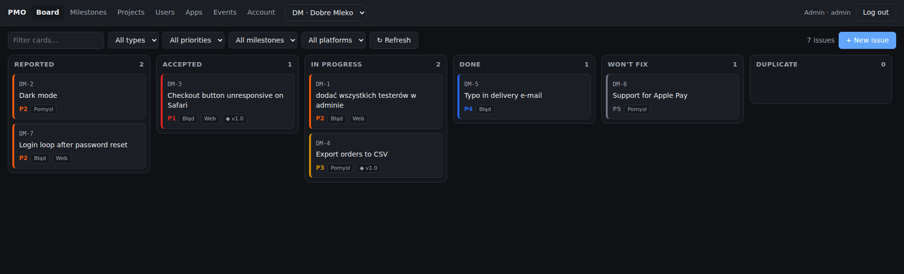
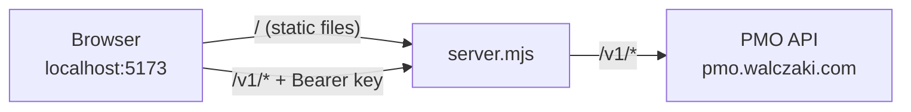

# pmo-client-local

A local, Trello-style web UI for the [PMO API](https://pmo.walczaki.com/docs): a kanban board for issues, plus screens for every other part of the API: milestones, projects, users, apps, API keys and the action log.

No build step and no npm dependencies. It's plain ES modules served by a small Node server.



## Quick start

Requires **Node.js 20.11+**.

```bash
git clone git@github.com:mwalczak/pmo-client-local.git
cd pmo-client-local
npm start
```

Open <http://localhost:5173> and paste your PMO API key (`pmo_u_…` for a user, `pmo_a_…` for an app).

## Features

| Screen | What you can do |
|---|---|
| **Board** | One column per status (Reported → Accepted → In progress → Waiting for release → In review (UAT) → Done / Won't fix / Duplicate). Drag a card to change its status; the board scrolls when you hold a card near its edge. Cards show their comment count. Filter by text, type, priority, milestone and platform. Create issues, including the reporter and attachments. |
| **Issue** | Edit title, description, status, type, priority, platform, milestone, privacy and duplicate-of. Preview, upload, download and delete screenshots and videos. Comment Jira-style: press <kbd>M</kbd> to write, <kbd>Ctrl</kbd>+<kbd>Enter</kbd> to save, edit or delete your comments, sort newest/oldest first; admins can post internal comments. Read the issue's full history. |
| **Milestones** | Create, edit, close/reopen and delete. See issue progress and overdue dates, and jump to the board filtered by milestone. |
| **Projects** | Create projects and configure their issue types and platforms. |
| **Users** *(admin)* | Search, create (optionally e-mailing a key), change role, delete, manage each user's keys. |
| **Apps** *(admin)* | Create server-to-server apps, choose which projects they can reach, rotate and revoke their keys. |
| **Events** *(admin)* | Browse the action log with every filter the API offers. |
| **Account** | Who you are, and your own keys: create one per agent or tool, revoke old ones. |

The UI hides what your role can't do, but the API has the final say: a refused action shows up as an error notification.

## How it works



The PMO API doesn't send CORS headers, so a browser can't call it from another site. `server.mjs` serves the UI and forwards `/v1/*` requests (with your `Authorization` header) to the API, so the browser only ever talks to one host.

## Configuration

| Variable | Default | Purpose |
|---|---|---|
| `PORT` | `5173` | Port of the local server |
| `PMO_API` | `https://pmo.walczaki.com` | API to forward `/v1/*` to, e.g. a local PMO instance |

```bash
PORT=8080 PMO_API=http://localhost:3000 npm start
```

## Security notes

- The server listens on `127.0.0.1` only, so other machines can't reach it.
- Your key is kept in the browser's `localStorage` and sent only to the local server, which passes it on to the API. It's never written to disk on the server side. **Log out** clears it. Don't use this on a shared machine.
- New API keys are shown once, right after you create them. Copy them then.
- Changing an issue's status e-mails its reporter (that's how the API works), so dragging cards around notifies real people.

## Project structure

```
server.mjs              static file server + /v1 proxy
public/
  index.html            app shell
  styles.css            light/dark theme
  js/
    api.js              one function per API endpoint
    state.js            session state, constants, permissions
    ui.js               escaping templates, dialogs, forms, tables, notifications
    main.js             login, navigation, hash routing
    views/
      board.js          kanban board + drag & drop
      issue.js          issue window (details, attachments, history), new issue form
      milestones.js  projects.js  users.js  apps.js  events.js  account.js  keys.js
```

Each view exports `{ label, mount(root) }`, plus `usesProject` / `adminOnly` flags. Routes are `#/board`, `#/milestones`, `#/projects`, `#/users`, `#/apps`, `#/events` and `#/account`.
